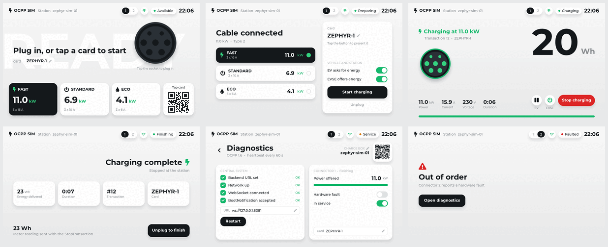

# ocpp-sim

An OCPP 1.6 charge point simulator on [Zephyr RTOS](https://zephyrproject.org):
Zephyr's own OCPP library, simulated connectors and an LVGL charging station
display. It runs on `native_sim` against a local
[CitrineOS](https://github.com/citrineos/citrineos-core).



```sh
west build -b native_sim/native/64 -d build/native ocpp-sim/app
docker compose -f ocpp-sim/tools/citrineos/compose.yml up -d
ocpp-sim/tools/citrine.py setup
./build/native/zephyr/zephyr.exe
```

## Documentation

The full documentation is at <https://walidbadar.github.io/ocpp-sim/>.

- [Getting started](https://walidbadar.github.io/ocpp-sim/getting_started.html):
  requirements, building and a first charging session.
- [The simulator](https://walidbadar.github.io/ocpp-sim/simulator.html): the
  screens, the `sim` shell commands and the configuration.
- [CitrineOS](https://walidbadar.github.io/ocpp-sim/citrineos.html): the local
  stack and `tools/citrine.py`.
- [Architecture](https://walidbadar.github.io/ocpp-sim/architecture.html):
  source files, threads and the use of the OCPP library.
- [Troubleshooting](https://walidbadar.github.io/ocpp-sim/troubleshooting.html):
  log messages, their causes and the limits.

## Licence

Apache-2.0. See the [licence page](https://walidbadar.github.io/ocpp-sim/licence.html) for the bundled font and
trademarks.
