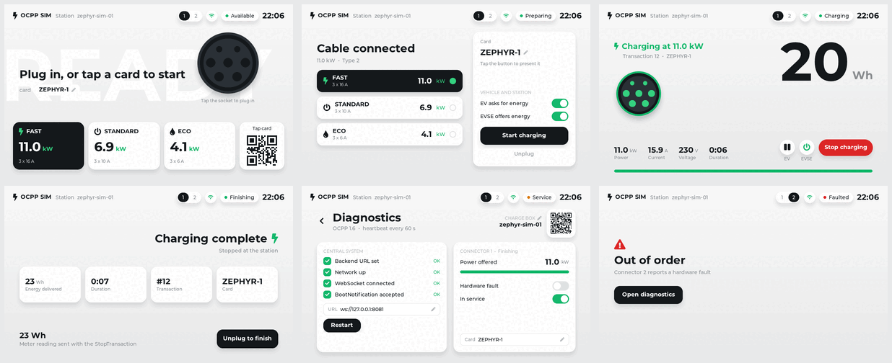

..
   Copyright (c) 2026 Muhammad Waleed Badar
   SPDX-License-Identifier: Apache-2.0

ocpp-sim
########

An OCPP 1.6 charge point simulator on `Zephyr RTOS <https://zephyrproject.org>`_.
It uses Zephyr's own OCPP library to talk to a central system, simulates the
connectors behind it and shows a charging station display built with LVGL. It
runs on ``native_sim``, so no hardware is needed, and is set up to work
against a local `CitrineOS <https://github.com/citrineos/citrineos-core>`_.

         Complete, Diagnostics and Out of order
   :width: 840
   :align: center

   On ``native_sim`` at 800x480: Ready, Connected, Charging, Complete,
   Diagnostics and Out of order.

Features
********

- BootNotification, Heartbeat, Authorize, StartTransaction, MeterValues and
  StopTransaction towards the central system; RemoteStartTransaction,
  RemoteStopTransaction, UnlockConnector, GetConfiguration and
  ChangeConfiguration from it.
- Two simulated connectors (one to four by configuration), each with its
  OCPP 1.6 status, a card reader and an energy meter.
- A display that follows the connector through a charging session, and a
  diagnostics page for the link to the central system.
- Everything the display does is also a ``sim`` shell command, so that
  sessions can be scripted.
- Backend URL, charge box identity and cards are kept in flash.

.. toctree::
   :maxdepth: 2
   :caption: Contents

   getting_started
   simulator
   citrineos
   architecture
   troubleshooting
   licence
